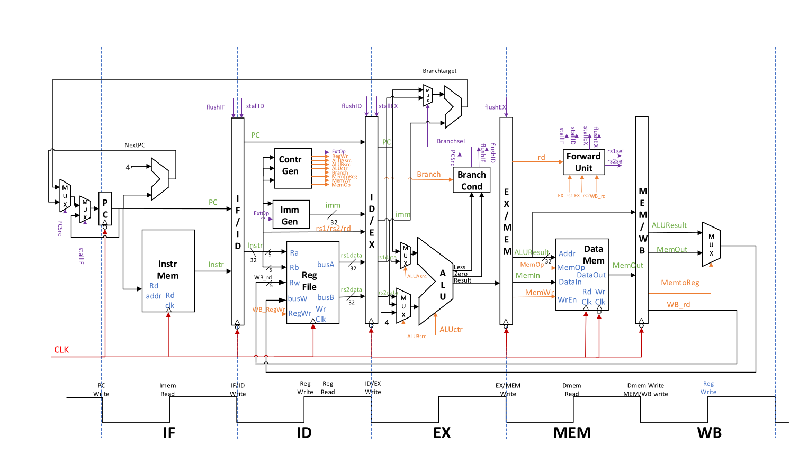

# RV32I Five-Stage Pipeline CPU

A synthesizable five-stage RV32I processor implemented in Verilog. The design uses an external instruction-memory and data-memory interface, so the CPU core does not depend on vendor RAM IP.

## Architecture



```text
IF -> IF/ID -> ID -> ID/EX -> EX -> EX/MEM -> MEM -> MEM/WB -> WB
```

- Five pipeline stages: instruction fetch, decode, execute, memory, and write-back
- Pipeline state advances on the falling edge of the CPU clock
- Register-file write-back occurs on the rising edge
- Branches and jumps resolve in EX and flush the two younger instructions
- One-cycle stall for load-use hazards
- EX/MEM and MEM/WB forwarding to EX
- Forwarded operands are preserved across a load-use stall
- `x0` is hardwired to zero

## Supported RV32I Instructions

- Arithmetic: `ADD`, `SUB`, `ADDI`, `LUI`, `AUIPC`
- Shifts: `SLL`, `SRL`, `SRA`, `SLLI`, `SRLI`, `SRAI`
- Logic: `AND`, `OR`, `XOR`, `ANDI`, `ORI`, `XORI`
- Comparisons: `SLT`, `SLTU`, `SLTI`, `SLTIU`
- Loads: `LB`, `LH`, `LW`, `LBU`, `LHU`
- Stores: `SB`, `SH`, `SW`
- Branches: `BEQ`, `BNE`, `BLT`, `BGE`, `BLTU`, `BGEU`
- Jumps: `JAL`, `JALR`

## Hazard Handling

| Hazard | Resolution |
| --- | --- |
| ALU result dependency | EX/MEM or MEM/WB forwarding |
| Store-data dependency | Forwarding to the store-data path |
| Branch operand dependency | Forwarding to EX branch comparison |
| Load-use dependency | One-cycle stall and EX/MEM bubble |
| Taken branch or jump | Two younger instructions flushed |

## External Interface

The top-level module is `rv32ip`.

```verilog
module rv32ip(
    input  wire        clock,
    input  wire        reset,
    output wire [31:0] imemaddr,
    input  wire [31:0] imemdataout,
    output wire        imemclk,
    output wire [31:0] dmemaddr,
    input  wire [31:0] dmemdataout,
    output wire [31:0] dmemdatain,
    output wire        dmemrdclk,
    output wire        dmemwrclk,
    output wire [2:0]  dmemop,
    output wire        dmemwe,
    output wire [31:0] dbgdata
);
```

`dbgdata` exposes the current PC. The register-file instance is named `myregfile`, and its storage array is named `regs` for hierarchical verification.

## Repository Layout

```text
rtl/
  rv32ip.v
README.md
```

## Compile Check

```bash
iverilog -g2012 -Wall -s rv32ip -tnull rtl/rv32ip.v
```

## Design Scope

The core implements the unprivileged integer datapath required by the course workloads. Interrupts, exceptions, CSRs, caches, and privileged modes are outside the project scope.
